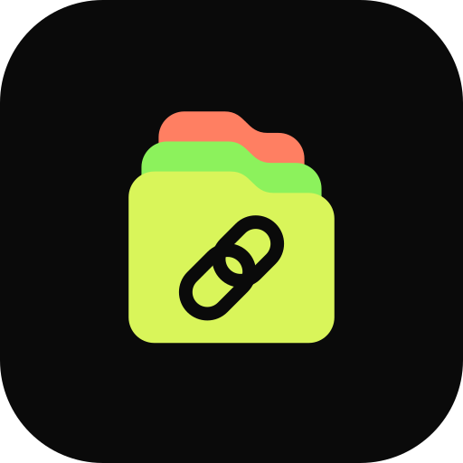

# LinkVault

A private, offline-first link manager for Android. Save links from any app with **Share → LinkVault**, organise them with categories and tags, search instantly, and open each one in the right app.

<p align="center"></p>

## Highlights
- Share-sheet capture, clipboard suggestion, duplicate detection (Open / Update / Save anyway)
- Platform detection (YouTube, Instagram, Telegram, WhatsApp, GitHub, Drive, Docs, Spotify, Amazon, Flipkart, Facebook, LinkedIn, X, Reddit, Netflix, any website)
- Smart open: native app when installed, otherwise your default browser (setting: Smart / Browser / App)
- Categories (add, rename, delete, icon, reorder), tags, favorites, pinned links, most-used
- Instant search over title, URL, domain, category, tags and notes; sort and filter sheet
- Swipe right = favorite, swipe left = edit/delete, long-press = multi-select with bulk actions (with Undo)
- Backup & restore, JSON / CSV export, import with merge / skip duplicates / replace
- Optional PIN + biometric app lock (PBKDF2-hashed PIN, screenshots blocked while lock is on)
- Home-screen widget (pinned links) and launcher shortcuts (Add, Favorites, Pinned, Search)
- Splash screen (Android 12+ system splash, backported to Android 8+), held until settings load
- **Built-in downloader**: download video or audio from a saved link (or any pasted link) with yt-dlp. Pick Best / 1080p / 720p / 480p or audio-only (M4A / MP3), queue several, watch progress in a notification, cancel or retry. Files are saved to `Movies/LinkVault` and `Music/LinkVault`
- **Floating button** (optional): after you minimize LinkVault, a small draggable button stays over other apps. Tap it, the copied link is filled in, then Save it or Download it. Drag it to the X to hide it. Turn it on in Settings → Floating button (needs the *display over other apps* permission)
- Short branded splash on launch with the founder's name (tap to skip)
- Light, Dark and System themes; no account, no analytics, no ads

## Stack
Kotlin · Jetpack Compose (Material 3) · Room · DataStore · Navigation Compose · AndroidX Biometric · yt-dlp via youtubedl-android (downloads). `minSdk 26`, `targetSdk 35`.

## Build
**GitHub Actions (no setup):** push to GitHub; the *Build LinkVault APK* workflow produces `LinkVault-debug-apk` and `LinkVault-release-apk` artifacts (Actions tab → run → Artifacts).

**Locally:** open the folder in Android Studio (Ladybug or newer, JDK 17) and run, or from a terminal with Gradle 8.9+:

```
gradle :app:assembleDebug
```
The APK is at `app/build/outputs/apk/debug/`. (To add the Gradle wrapper: `gradle wrapper --gradle-version 8.9`.)

### Signing a release build (optional)
Without secrets the release APK is signed with the debug key (installable, not for the Play Store). For your own key, add these repository secrets:
`KEYSTORE_BASE64` (base64 of your .jks), `KEYSTORE_PASSWORD`, `KEY_ALIAS`, `KEY_PASSWORD`.

## Project layout
```
app/src/main/java/com/linkvault/app/
  data/     Room entities, DAOs, repository, backup format, DataStore settings
  util/     URL parsing/normalising, platform detection, link opener, PIN hashing, metadata
  ui/       theme, reusable components, screens
  bubble/   floating button overlay service + the quick-add panel it opens
  download/ yt-dlp engine, foreground download service, queue controller, media-library saver
  widget/   pinned-links widget + open trampoline
branding/   logo (SVG + 512px PNG) and alternatives; the app icon is res/drawable/ic_launcher_foreground.xml
```

## Downloads
Tap **Download** on any link (or paste one in Settings → Downloads). yt-dlp runs on the device inside a foreground service, one download at a time, and the result is copied into the shared media library, so it needs no storage permission. If a site stops working, use **Settings → Downloads → Update yt-dlp**.

Notes:
- The APK is much larger than a plain link manager (it bundles Python and ffmpeg); the per-ABI APKs from CI are smaller than the universal one.
- The downloader libraries are GPL-3.0, which applies to a distributed APK of this app.
- Google Play forbids apps that download YouTube content, so distribute via GitHub / F-Droid / direct APK.
- Only download content you have the right to save; many sites forbid it in their terms.

## Data & privacy
Everything lives in a local Room database. Network use only happens when you ask for it: the optional title/favicon request when you add a link (Settings → Home → *Fetch page titles*), and, when you tap Download, a connection to the site that hosts the link. *Update yt-dlp* fetches the downloader from its public release page. Cloud backup is disabled; use *Backup & Restore*.
